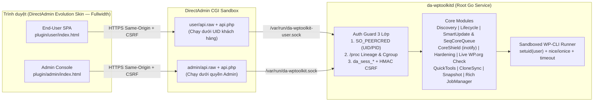

<div align="center">
  
  <h1>WordPress Manager</h1>
  <p><strong>Bộ Công Cụ Quản Trị Vòng Đời, Bảo Mật Đa Tầng &amp; Tự Phục Hồi WordPress cho DirectAdmin</strong></p>

  <p>
    <a href="https://github.com/shostwp-byte/da-wordpresstoolkit/actions/workflows/ci.yml"></a>
    <a href="https://github.com/shostwp-byte/da-wordpresstoolkit/releases/latest"></a>
    
    
    
    <a href="./LICENSE"></a>
  </p>
</div>

---

**WordPress Manager** (`da_wp_toolkits`) là giải pháp quản trị WordPress gốc (**Native Linux Daemon + DirectAdmin Evolution Skin Plugin**) viết hoàn toàn bằng **Golang chuẩn (`CGO_ENABLED=0`, 0 thư viện ngoài trong `go.mod`)**, được thiết kế chuyên biệt cho nhà cung cấp Shared/Cloud Hosting và người dùng cuối trên DirectAdmin.

<div align="center">
  
</div>

---

## Điểm Khác Biệt Cốt Lõi

- **Kiến trúc Siêu Nhẹ & Tự Chủ 100%:** Biên dịch thành một tệp thực thi tĩnh duy nhất (`~8.6 MB` trên `linux/amd64`, `~7.9 MB` trên `linux/arm64`), tiêu thụ `< 20 MB RAM` ở trạng thái nghỉ, không cần Node.js/Python/SQLite hay bất kỳ runtime phụ trợ nào trên máy chủ DirectAdmin.
- **Giao Diện Fullwidth Hiện Đại Chuẩn WordPress Manager:** Tích hợp mượt mà không viền hộp dư thừa trên **DirectAdmin Evolution Skin** cho cả Admin và End-User; hỗ trợ **Dark Mode**, song ngữ **Việt / Anh**, 3 chế độ hiển thị (*Cards / Grid / Compact List*), tự động thu gọn thẻ thông minh khi tài khoản có nhiều website kèm nút **Mở rộng / Thu gọn tất cả** và phản hồi giao diện `< 50ms`.
- **Cập Nhật WordPress Core Hàng Loạt Tuần Tự (`Sequential Queue 1-by-1`):** Đối chiếu trực tiếp phiên bản mới nhất với `api.wordpress.org`, đưa nhiều website vào hàng đợi nâng cấp **tuần tự từng site một** để không gây đột biến CPU/RAM/Disk I/O, đồng thời **tự động bỏ qua** các site đã ở phiên bản mới nhất.
- **Cập Nhật An Toàn Tự Hoàn Tác (`Smart Safe Update`):** Đối chiếu trực tiếp phiên bản mới của Plugins/Themes từ kho WordPress.org, tự động sao lưu trước khi nâng cấp, kiểm tra sức khỏe HTTP loopback sau cập nhật và **tự động Rollback dưới 3 giây** nếu phát hiện lỗi `HTTP 500` / PHP Fatal Error (WSOD).
- **Tự Bảo Vệ & Phục Hồi Tức Thời (`Core Integrity Shield`):** Giám sát thời gian thực thư mục nhân WordPress qua `Linux inotify`, tự động cách ly mã độc/webshell lạ vào **Quarantine Vault** (kèm trình xem **Unified Diff**) và khôi phục tệp gốc từ **Local Verified Core Cache** trong `< 50ms` với quyền sở hữu chuẩn `<user>:<user>` (giúp cập nhật trực tiếp ngay trong `wp-admin` không bị hỏi tài khoản FTP), hoặc khóa cứng mức hệ điều hành với **Fortress Core Lock (`root:<user>`)**.
- **Bảo Mật IPC 3 Lớp Chống Giả Mạo Từ Webshell:** Tách biệt hoàn toàn Unix Socket của Admin và End-User, xác thực đồng thời `SO_PEERCRED` mức nhân Linux, phả hệ tiến trình `/proc/<pid>` của DirectAdmin (chặn đứng PHP-FPM/LSPHP webshell trên cùng UID khách hàng) và phiên `da_sess_*` + `HMAC-SHA256 CSRF`.

---

## Tổng Hợp Tính Năng

| Phân hệ | Tính năng chi tiết |
| :--- | :--- |
| **Quản lý Vòng đời & SSO** | Tự động quét phát hiện WordPress không thực thi PHP (`Zero-Eval Discovery`, 200 site `< 1.5s`), cài đặt **1-Click Express/Custom** từ kho đệm nội bộ, **Đăng nhập 1-Click SSO (`Login`)** tự hủy sau 45 giây không để lại plugin rác, gỡ cài đặt an toàn bảo toàn Subdomain anh em. |
| **Cập nhật WP Core Tuần tự** | Kiểm tra hàng loạt phiên bản WordPress hiện tại từ `wp-includes/version.php` đối chiếu `api.wordpress.org`, kiểm tra tương thích PHP tối thiểu, xếp hàng đợi cập nhật **tuần tự 1-by-1** tiết kiệm tài nguyên, tự động bỏ qua site đã mới nhất và đồng bộ lại Core Shield. |
| **Plugins, Themes & Sets** | Kiểm tra trực tiếp trạng thái kích hoạt & phiên bản mới từ `api.wordpress.org` (không lệ thuộc WP-Cron), bật/tắt/cập nhật/xóa đơn lẻ hoặc hàng loạt đa site (`--skip-plugins --skip-themes` cứu hộ cả khi WSOD), tải lên gói `.zip` phân mảnh tới **64 MB** chống Zip-Slip, quản lý **Sets**. |
| **Smart Safe Update & CVE** | Sao lưu vi mô trước khi cập nhật Plugins/Themes, kiểm tra phản hồi HTTP thực tế và hoàn tác tự động `< 3s` nếu phát sinh lỗi 500; tích hợp luồng cảnh báo lỗ hổng **Wordfence Community CVE Feed** miễn phí không cần API key trả phí. |
| **Tác vụ nền Thời gian thực** | Thanh trạng thái **Live Task Banner** & ngăn kéo **Background Tasks Drawer** hiển thị rõ tác vụ nào đang chạy, phần trăm tiến độ, từng website đang nâng cấp / chờ lượt / bỏ qua / hoàn tất kèm chức năng dọn lịch sử tác vụ. |
| **Core Integrity Shield** | 3 chế độ bảo vệ (*Monitor*, *Auto-Heal `< 50ms`*, *Fortress Core Lock `root:<user>`*), tự chuẩn hóa quyền `<user>:<user>` để `wp-admin` hoạt động mượt không hỏi FTP, **Anti-Thrashing Guard**, **Quarantine Unified Diff**, tự động mở/khóa khi chạy **DirectAdmin Backup Hooks**. |
| **Đa Web Server Hardening** | Bộ **12 quy tắc gia cố bảo mật** một chạm, tự động sinh cấu hình chuẩn xác cho **Apache**, **LiteSpeed Enterprise**, **OpenLiteSpeed** (tự gom lệnh graceful reload chống nghẽn) và **Nginx Standalone** (kiểm tra `nginx -t` trước khi áp dụng). |
| **Quick Tools** | Công tắc bật/tắt nhanh: *Search Engine Indexing*, *Caching (LSCache / Redis Object Cache cô lập `WP_CACHE_KEY_SALT`)*, *Maintenance Mode 503 tùy biến*, *Debugging (`WP_DEBUG` + trình đọc ngược 32 KB cuối `debug.log`)*, *HTTP Basic Auth `.htpasswd` ngoài `public_html`*, *Tiếp quản `wp-cron.php` sang System Cron DirectAdmin*. |
| **Clone, Staging & Sync** | Nhân bản 1-Click sang Domain/Subdomain mới, tự động gắn `noindex` cho môi trường Staging, thay thế URL an toàn cho dữ liệu **PHP Serialized** & **Elementor JSON** (có xem trước *Dry-Run*), đồng bộ 2 chiều Staging ⇄ Production **bảo toàn đơn hàng & khách hàng WooCommerce**. |
| **Zstd Snapshots & DB** | Sao lưu & khôi phục toàn phần (Mã nguồn + Database `.sql`) nén chuẩn **Zstandard (`.tar.zst` RFC 8878)** tính vào đúng hạn mức dung lượng người dùng, tải trực tiếp về máy tính, tự động xoay vòng bản cũ; tối ưu/sửa bảng DB và chỉnh sửa an toàn hằng số `wp-config.php`. |
| **Server Admin Console** | Giao diện quản trị Fullwidth 4 Tab cho nhà cung cấp Hosting: *Tổng quan toàn máy chủ, Cập nhật WP Core/Smart Update toàn cục & Nhật ký bảo mật*, *Chính sách giới hạn theo Hosting Package & Global Sets*, *Kho đệm Core Cache & CSDL CVE*, *Tự động cập nhật từ GitHub Releases xác thực chữ ký số Ed25519*. |

---

## Kiến Trúc Hệ Thống & Bảo Mật 3 Lớp



### Nguyên tắc An toàn Bất biến (Security Invariants)

1. **Không bao giờ thực thi WP-CLI dưới quyền `root`:** Mọi tiến trình `wp-cli`, giải nén hay thao tác tệp trong không gian người dùng đều hạ quyền xuống đúng `UID/GID` của tài khoản DirectAdmin thông qua `SysProcAttr.Credential` kết hợp giới hạn tài nguyên `nice` / `ionice` và timeout cứng.
2. **Chống leo thang đặc quyền qua Symlink (`internal/fsguard`):** Kiểm tra từng chặng đường dẫn (component-by-component `Lstat`), từ chối mọi symlink trỏ ra ngoài `/home/<user>/domains` trước khi đọc, ghi, sao lưu, đặt quyền hay xóa.
3. **Không rò rỉ thông tin nhạy cảm trên Command-Line (`ps aux`):** Mật khẩu quản trị WordPress, thông tin kết nối MariaDB (`--defaults-extra-file` `0600`) và `GitHubToken` không bao giờ truyền qua tham số dòng lệnh hay trả ngược về giao diện.

---

## Cấu Trúc Thư Mục Dự Án

```text
da-wordpresstoolkit/
├── cmd/da-wptoolkit/         # Điểm vào CLI quản trị & tiến trình nền da-wptoolkitd
├── internal/
│   ├── auth/                 # Xác thực IPC 3 lớp (SO_PEERCRED, /proc lineage, da_sess_*, HMAC CSRF)
│   ├── clonesync/            # Nhân bản Staging, PHP Serialized Search-Replace & Đồng bộ WooCommerce
│   ├── config/               # Quản lý chính sách theo Hosting Package & cấu hình GitHub Updater
│   ├── dadomains/            # Phân giải Domain, Addon Domain, Subdomain & SSL từ DirectAdmin
│   ├── daemon/               # Điều phối dịch vụ IPC, Job Queue & Admin/User Handlers
│   ├── daphp/                # Ánh xạ phiên bản PHP CustomBuild trên từng tên miền
│   ├── database/             # Cấp phát MySQL/MariaDB tương thích DirectAdmin 1.670+
│   ├── dausers/              # Đọc thông tin tài khoản, UID/GID & Hosting Package DirectAdmin
│   ├── discovery/            # Quét phát hiện WordPress tĩnh tốc độ cao (Zero-Eval PHP)
│   ├── extensions/           # Quản lý Plugins, Themes, Sets, Live WP.org Update Check & kiểm duyệt .zip
│   ├── fsguard/              # Lá chắn chống tấn công Symlink Escape & TOCTOU
│   ├── hardening/            # Engine 12 quy tắc gia cố bảo mật WordPress
│   ├── integrity/            # Core Integrity Shield (inotify, Quarantine Diff, Ownership & Fortress Lock)
│   ├── ipc/                  # Máy chủ/máy khách Dual Unix Domain Socket giới hạn khung 64 KB
│   ├── lifecycle/            # Cài đặt 1-Click từ Core Cache, Ephemeral SSO 45s & Gỡ cài đặt
│   ├── quicktools/           # Maintenance, WP_DEBUG Tail, Basic Auth, Cron, Cache & wp-config
│   ├── smartupdate/          # Smart Safe Update (< 3s Auto-Rollback) & Hàng đợi cập nhật WP Core tuần tự
│   ├── snapshot/             # Nén & giải nén bản sao lưu Zstandard (.tar.zst RFC 8878)
│   ├── store/                # Kho lưu trữ JSON nguyên tử, Rich JobManager & Nhật ký bảo mật
│   ├── updater/              # Tự động cập nhật xác thực chữ ký số Ed25519 + Auto-Rollback < 10s
│   ├── version/              # Định danh phiên bản & khóa công khai Ed25519 xác thực bản phát hành
│   ├── vulndb/               # Đồng bộ & đối chiếu cơ sở dữ liệu lỗ hổng Wordfence CVE
│   ├── webserver/            # Bộ điều hợp cấu hình Apache, LiteSpeed, OpenLiteSpeed & Nginx
│   └── wpcli/                # Trình chạy WP-CLI hạ quyền UID/GID kèm kiểm soát I/O
├── plugin/                   # Gói tích hợp DirectAdmin Evolution Skin (Fullwidth)
│   ├── admin/                # Bảng điều khiển Server Admin (4 Tabs) & cầu nối IPC api.php
│   ├── user/                 # Giao diện WordPress Manager cho End-User & Chunked Upload api.php
│   ├── hooks/                # Điểm gắn menu & biểu tượng trên DirectAdmin Evolution Skin
│   ├── images/               # Biểu tượng vector SVG cho User & Admin
│   ├── scripts/              # Vòng đời cài đặt / cập nhật / gỡ bỏ qua DirectAdmin Plugin Manager
│   └── plugin.conf           # Khai báo metadata plugin DirectAdmin
├── scripts/                  # Trình cài đặt 1-Click (install/uninstall/update/package) & QA
│   └── da_hooks/             # 9 DirectAdmin Lifecycle Subdirectory Hooks (User/Domain/Backup)
├── systemd/                  # Cấu hình dịch vụ hệ thống da-wptoolkitd.service
└── docs/                     # Đặc tả giao thức IPC & Sổ tay vận hành hệ thống (RUNBOOK.md)
```

---

## Yêu Cầu Hệ Thống

- **Hệ điều hành:** CloudLinux 8/9, AlmaLinux 8/9, Rocky Linux 8/9, Ubuntu 20.04/22.04/24.04 hoặc Debian 11/12 (`x86_64` / `amd64` và `aarch64` / `arm64`).
- **Control Panel:** DirectAdmin `1.670+` sử dụng giao diện **Evolution Skin**.
- **Web Server hỗ trợ:** OpenLiteSpeed, LiteSpeed Enterprise, Apache (`mod_ruid2` / `PHP-FPM`) hoặc Nginx Standalone / Reverse Proxy.
- **Cơ sở dữ liệu & Công cụ:** MySQL `8.0+` hoặc MariaDB `10.4+` – `11.x`, PHP CLI (CustomBuild) và `wp-cli` (`/usr/local/bin/wp`).

---

## Cài Đặt & Cập Nhật 1-Click Trên Máy Chủ DirectAdmin (`root`)

### Cách 1: Cài đặt hoặc nâng cấp nhanh bằng 1 dòng lệnh (Khuyến nghị)

```bash
curl -fsSL https://raw.githubusercontent.com/shostwp-byte/da-wordpresstoolkit/main/scripts/install.sh | sudo bash
```

### Cách 2: Cài đặt từ kho mã nguồn Git

```bash
git clone https://github.com/shostwp-byte/da-wordpresstoolkit.git
cd da-wordpresstoolkit
sudo bash scripts/install.sh
```

Trình cài đặt `scripts/install.sh` tự động kiểm tra kiến trúc CPU (`amd64` / `arm64`), tải bản phát hành mới nhất từ GitHub Releases (hoặc tự biên dịch nếu chạy từ mã nguồn có sẵn Go), xác thực `SHA-512` của `wp-cli`, cấu hình hạn mức nhân `fs.inotify.max_user_watches = 524288`, triển khai nhị phân `/usr/local/sbin/da-wptoolkit`, cấp quyền menu plugin cho toàn bộ tài khoản DirectAdmin, cài đặt **9 DirectAdmin Lifecycle Hooks**, khởi chạy `da-wptoolkitd.service`, đồng bộ dữ liệu CVE và quét nhận diện toàn bộ website WordPress hiện có.

### Cập nhật phiên bản mới & Khôi phục (Self-Update & Instant Rollback)

- **Trên giao diện DirectAdmin Admin:** Mở **WordPress Manager → Tab 4: Hệ thống & Cập nhật GitHub → Kiểm tra bản mới → Cập nhật nguyên tử** (tự động kiểm chứng chữ ký số `Ed25519` + `SHA-256` và sao lưu bản cũ).
- **Qua dòng lệnh SSH (`root`):**
  ```bash
  da-wptoolkit check-update
  da-wptoolkit update
  da-wptoolkit rollback --list
  ```

---

## Hướng Dẫn Biên Dịch & Kiểm Thử Từ Mã Nguồn

### 1. Yêu cầu môi trường phát triển

- **Go `1.22+`** (biên dịch hoàn toàn với `CGO_ENABLED=0`, không cần trình biên dịch C).

### 2. Biên dịch nhị phân tĩnh & đóng gói phát hành

```bash
# Kiểm tra định dạng, phân tích tĩnh (go vet), chạy toàn bộ Unit Test và biên dịch
make all

# Biên dịch chéo nhị phân tĩnh cho Linux x86_64 & ARM64
make build-linux-amd64
make build-linux-arm64

# Đóng gói trọn bộ hiện vật phát hành (amd64, arm64 & da_wp_toolkits.tar.gz)
make package
```

### 3. Chạy bộ kiểm thử tự động

```bash
# Chạy toàn bộ 23 package kiểm thử tích hợp, bảo mật & Stress Test (500 accounts / 1.000 sites)
CGO_ENABLED=0 go test -v -race ./...

# Trên máy chủ DirectAdmin thực tế: kiểm tra trạng thái socket, daemon và 9 hooks
bash scripts/qa_verify.sh preflight
```

### 4. Một số lệnh quản trị CLI tiêu biểu (`da-wptoolkit`)

```bash
# Kiểm tra phiên bản và kết nối tới tiến trình nền da-wptoolkitd
da-wptoolkit version
da-wptoolkit ping

# Quét tự động toàn bộ website WordPress trên máy chủ
da-wptoolkit scan --all

# Liệt kê danh sách các website WordPress (hoặc lọc riêng các site có cảnh báo CVE)
da-wptoolkit list
da-wptoolkit list --vuln

# Kiểm tra tính toàn vẹn nhân WordPress và đồng bộ dữ liệu lỗ hổng CVE
da-wptoolkit verify-core --all
da-wptoolkit sync-vulndb

# Kiểm tra, cập nhật nguyên tử xác thực Ed25519 và khôi phục tức thời (Rollback)
da-wptoolkit check-update
da-wptoolkit update
da-wptoolkit rollback --list
```

---

## Lịch Sử Phát Triển & Các Cột Mốc Phiên Bản

- [x] **Giai đoạn 0 (`v0.1.0`):** Kiến trúc Monorepo, Kho lưu trữ nguyên tử `internal/store`, Hàng đợi tác vụ nền `JobManager`, Bảo mật IPC 3 lớp và khung CI/CD đa kiến trúc.
- [x] **Giai đoạn 1 (`v0.2.0`):** Bộ phân giải Domain/PHP DirectAdmin, lá chắn chống Symlink `fsguard`, Zero-Eval Auto-Discovery, Sandboxed WP-CLI, cấp phát Database & 1-Click Installer + Ephemeral SSO.
- [x] **Giai đoạn 2 (`v0.3.0`):** Quản lý tập trung Plugins/Themes/Sets đơn site & đa site, cứu hộ WSOD, **Smart Safe Update** tự hoàn tác `< 3s` & cảnh báo lỗ hổng **Wordfence CVE Feed**.
- [x] **Giai đoạn 3 (`v0.4.0`):** Bộ điều hợp Đa Web Server (Apache/LiteSpeed/OpenLiteSpeed/Nginx), 12 quy tắc gia cố bảo mật & **Core Integrity Shield** (`inotify` Auto-Heal + Quarantine Diff + Fortress Core Lock + Backup Hooks).
- [x] **Giai đoạn 4 (`v0.5.0`):** Bộ công cụ **Quick Tools**, sao lưu nén **Zstd Snapshots (`.tar.zst`)** & nhân bản **Clone / Staging / Bidirectional Sync** bảo toàn đơn hàng WooCommerce.
- [x] **Giai đoạn 5 (`v0.6.0`):** Giao diện **End-User WordPress Manager SPA** (Indigo/Slate, Dark Mode, VI/EN, Chunked `.zip` Upload 64 MB) & **Server Admin Console 4 Tabs** trên Evolution Skin.
- [x] **Giai đoạn 6 (`v1.0.0`):** Bộ **9 DirectAdmin Lifecycle Subdirectory Hooks**, trình tự động cập nhật xác thực chữ ký số **Ed25519 + Auto-Rollback `< 10s`**, Stress Test mật độ cao (`500` tài khoản / `1.000` site `< 25 MB RAM`) & phát hành `v1.0.0`.
- [x] **Bản nâng cấp `v1.0.1`:** Giao diện **Fullwidth không viền** đồng bộ trên Evolution Skin (Admin & End-User), kiểm tra trạng thái & phiên bản mới của Plugins/Themes trực tiếp từ `api.wordpress.org`, tự động chuẩn hóa quyền sở hữu tệp `<user>:<user>` loại bỏ hoàn toàn hộp thoại yêu cầu FTP khi cập nhật trong `wp-admin`.
- [x] **Bản nâng cấp `v1.0.2` (Hiện tại):** Bổ sung **cập nhật WordPress Core hàng loạt theo hàng đợi tuần tự (`1-by-1`)** tự động bỏ qua site đã ở phiên bản mới nhất, tự động thu gọn thẻ khi có `> 1` instance kèm nút **Mở rộng / Thu gọn tất cả** ở Card View, chuẩn hóa nút **`Login`** trên Grid/List View & nâng cấp trực quan thanh trạng thái **Tác vụ nền** thời gian thực.

---

## Tài Liệu Kỹ Thuật

- [Sổ Tay Vận Hành Hệ Thống & Xử Lý Sự Cố (`docs/RUNBOOK.md`)](./docs/RUNBOOK.md)
- [Đặc Tả Giao Thức IPC & Xác Thực 3 Lớp (`docs/IPC_PROTOCOL.md`)](./docs/IPC_PROTOCOL.md)
- [Đặc Tả Kỹ Thuật & Kế Hoạch Phát Triển Chi Tiết](./plan/Đặc%20Tả%20Kỹ%20Thuật%20&%20Kế%20Hoạch%20Phát%20Triển%20WordPress%20Manager.md)

---

## Giấy Phép (License)

Phát hành theo giấy phép [MIT License](./LICENSE) — Bản quyền © 2026 **CÔNG TY CỔ PHẦN W2W (SHOST)**.
