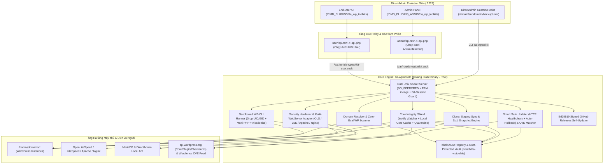
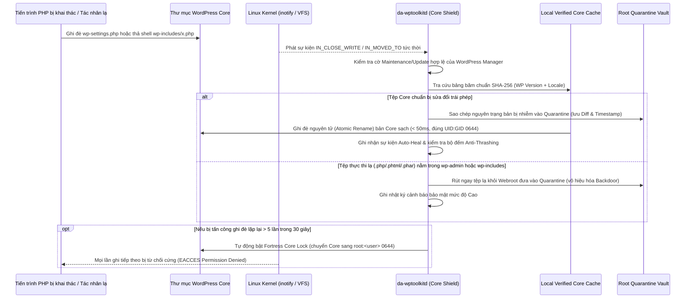
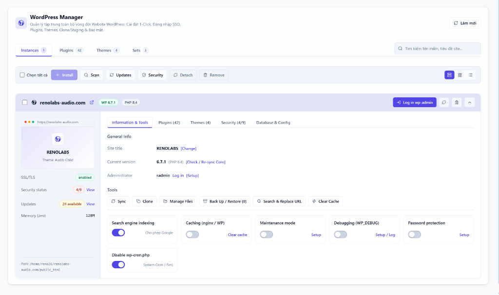

# ĐẶC TẢ KỸ THUẬT & KẾ HOẠCH PHÁT TRIỂN `WordPress Manager`

**Dự án:** Bộ Công Cụ Quản Trị, Bảo Mật & Tự Phục Hồi WordPress Đa Tầng cho DirectAdmin (`WordPress Manager` / `da_wp_toolkits`)  
**Phiên bản kế hoạch:** 1.0  
**Đối tượng sử dụng chính:** Người dùng cuối (End-User Hosting) + Bảng điều khiển quản trị gọn nhẹ cho SysAdmin  
**Công nghệ chốt:** Golang Static Daemon (`CGO_ENABLED=0`, `bbolt` ACID Store) + Sandboxed `WP-CLI` (Per-UID & Multi-PHP) + DirectAdmin Evolution Skin UI (HTML5/CSS3/JS + `.raw` PHP CGI) + Ed25519 GitHub Self-Updater  

---

## 1. ĐỊNH HƯỚNG SẢN PHẨM & 8 CHỐT CHẶN KỸ THUẬT CỐT LÕI

### 1.1. Tầm nhìn sản phẩm
Xây dựng một giải pháp **WordPress Manager gốc (Native)** tích hợp trực tiếp vào giao diện DirectAdmin Evolution Skin, mang lại trải nghiệm quản trị tập trung hiện đại cho khách hàng sử dụng dịch vụ Hosting, đồng thời giải quyết bài toán đau đầu nhất của nhà cung cấp Hosting: **mã nguồn WordPress bị chèn backdoor vào Core, plugin lỗi thời dính lỗ hổng CVE, và lỗi trắng trang (HTTP 500) khi khách hàng tự cập nhật**.

Dự án tuân thủ đồng bộ chuẩn kỹ thuật và bảo mật trong hệ sinh thái SHOST (cùng chuẩn với `DA-ResourceLimiter`): chạy cực nhẹ (**< 1% CPU**, **< 25MB RAM** nền cho máy chủ 500 tài khoản), không phụ thuộc thư viện động trên OS đích (Debian 12, Ubuntu 22.04/24.04, AlmaLinux 8/9, Rocky Linux 8/9).

### 1.2. Tám (08) chốt chặn kỹ thuật & an toàn bắt buộc trên môi trường Multi-Tenant

> [!IMPORTANT]
> Khác với plugin chỉ đọc thông số tài nguyên, `WordPress Manager` thực thi các tác vụ ghi dữ liệu (tạo DB, sửa cấu hình, mở khoá Core, xoá Snapshot). Tám chốt chặn dưới đây được thiết kế để ngăn chặn tuyệt đối nguy cơ leo thang đặc quyền hoặc phá hoại chéo khi một website của khách bị nhiễm mã độc.

| STT | Bẫy kỹ thuật trên Shared Hosting | Rủi ro thực tế nếu thiết kế ngây thơ | Giải pháp chuẩn hóa trong `WordPress Manager` |
| :--- | :--- | :--- | :--- |
| **1** | **Web-Shell lạm dụng Unix Socket cùng UID** | Nếu chỉ kiểm tra `SO_PEERCRED.Uid`, khi 1 site của user bị RCE (chạy PHP-FPM dưới cùng `UID`), hacker có thể gọi thẳng vào Socket để tắt chế độ bảo vệ Core hoặc xoá hết Backup của các site khác chung tài khoản. | **Xác thực 3 lớp tại Daemon:** (1) `SO_PEERCRED` lấy `UID` + `PID` từ Kernel; (2) Kiểm tra cây tiến trình cha (`/proc/<pid>/stat` lineage bắt buộc xuất phát từ `/usr/local/directadmin/directadmin`, từ chối mọi tiến trình con của `php-fpm`/`lsphp`/SSH); (3) Đối chiếu `SESSION_ID` trực tiếp với `/usr/local/directadmin/data/sessions/da_sess_*` (`0600 diradmin:diradmin`, mã độc của user không thể đọc) kèm `CSRF HMAC-SHA256`. |
| **2** | **Chạy `WP-CLI` sai quyền hoặc sai phiên bản PHP** | `wp-cli` thực thi trực tiếp `wp-config.php` và code PHP của plugin khách hàng. Chạy bằng `root` dẫn đến mất toàn bộ server; chạy bằng `/usr/bin/php` mặc định gây lỗi cú pháp nếu site yêu cầu PHP 8.1/8.3 hoặc bị kẹt do `disable_functions` khóa `proc_open`. | Bộ thực thi `internal/wpcli` tự động đọc `/usr/local/directadmin/data/users/<user>/domains/<domain>.conf` lấy đúng binary `/usr/local/phpXX/bin/php` của tên miền đó, hạ quyền xuống đúng `UID/GID` của user (`PR_SET_NO_NEW_PRIVS`), chống tấn công Symlink/TOCTOU (`O_NOFOLLOW` + kiểm chứng đường dẫn thật nằm trong `/home/<user>/domains/`) và mở riêng `-d disable_functions=""` trong phiên CLI có timeout cứng. |
| **3** | **Khác biệt cơ chế giữa OpenLiteSpeed, Apache & Nginx** | Trên **OpenLiteSpeed (OLS)**, ghi `.htaccess` không có tác dụng cho tới khi reload dịch vụ; trên **Nginx Standalone**, `.htaccess` bị bỏ qua hoàn toàn khiến các tính năng chặn PHP ở `uploads`, khoá `xmlrpc.php` hay Password Protect bị vô tác dụng. | Xây dựng **`internal/webserver` (Multi-WebServer Adapter)** đọc `options.conf` của CustomBuild: (1) **Apache / LiteSpeed Enterprise**: ghi `.htaccess` tức thời; (2) **OpenLiteSpeed**: ghi `.htaccess` kèm gom lô (debounce `2s`) gọi `/usr/local/lsws/bin/lswsctrl reload` không rớt kết nối; (3) **Nginx Standalone**: sinh snippet `/etc/nginx/da-wptoolkit/<user>/<id>.conf` nạp vào cấu hình user, kiểm tra `nginx -t` trước khi reload (lỗi tự rollback). |
| **4** | **Đa cấu trúc Subdomain của DirectAdmin** | DirectAdmin có cả Subdomain kiểu cũ (`public_html/sub`) lẫn kiểu mới/tuỳ chỉnh (`domains/sub.domain.com/public_html` hoặc `subdomains.docroot.override`). Quét thư mục thuần tuý sẽ nhận nhầm `sub.domain.com` thành thư mục con `domain.com/sub`. | Phân hệ **`internal/dadomains`** đọc trực tiếp metadata gốc của DirectAdmin (`domains.list`, `<domain>.conf`, `<domain>.subdomains`, `<domain>.subdomains.docroot.override`) để lập bản đồ `URL <-> DocumentRoot` chính xác 100% trước khi quét, loại trừ chồng lấn giữa Main Domain, Addon Domain, Subdomain và Subdirectory. |
| **5** | **Tạo Database trực tiếp qua SQL làm lệch DirectAdmin** | Nếu chỉ chạy lệnh `CREATE DATABASE` trực tiếp trong MariaDB, Database mới sẽ không hiển thị đúng trên trang *MySQL Management* của DirectAdmin hoặc bỏ lỡ hook giới hạn của `DA-ResourceLimiter`. | Khởi tạo/xoá Database thông qua **DirectAdmin Local API (`CMD_API_DATABASES`)** (kèm fallback chuẩn cấu trúc DA + kích hoạt `database_user_create_post.sh`), đảm bảo đồng bộ 100% giao diện DirectAdmin, Disk Quota và giới hạn kết nối MySQL. |
| **6** | **Xung đột Redis / LiteSpeed Object Cache khi Clone** | Khi nhân bản `domain.com` sang `staging.domain.com` trên cùng tài khoản, cả 2 site dùng chung khóa Redis. Sửa dữ liệu trên bản Staging làm ghi đè cache của bản chính, khiến trang Production tự nhảy URL sang trang Staging. | Luồng **Clone & Staging** tự động sinh mới hằng số `WP_CACHE_KEY_SALT` độc lập ghi vào `wp-config.php` của bản đích, xoá cache cục bộ bản đích, tự bật `blog_public = 0` (`noindex` chặn Google index nhầm) và cô lập tiền tố bảng `$table_prefix` tuỳ chọn. |
| **7** | **Plugin SSO để lại rác và mở rộng bề mặt tấn công** | Cài cố định một plugin SSO vào `wp-content/plugins/` dễ bị khách hàng xoá nhầm hoặc tạo nguy cơ bảo mật nếu tồn tại lâu dài. | Cơ chế **Zero-Residue Ephemeral SSO**: Chỉ sinh tệp tạm `wp-content/mu-plugins/.da-wptk-sso.php` với mã băm dùng 1 lần (hết hạn sau **45 giây**), tự huỷ tệp ngay khoảnh khắc đăng nhập thành công vào `wp-admin` (kèm luồng dọn rác nền sau 60s). |
| **8** | **Vòng lặp ghi đè (Thrashing) khi mã độc phá Core liên tục** | Nếu tiến trình PHP bị khai thác chạy vòng lặp sửa `index.php` liên tục mỗi giây và Daemon liên tục ghi đè lại, ổ cứng sẽ bị nghẽn I/O. | **Anti-Thrashing Escalation**: Khi một instance kích hoạt Auto-Heal vượt quá ngưỡng (mặc định `5 lần / 30 giây`), Daemon tự động nâng cấp tạm thời instance đó lên chế độ **Fortress Core Lock (`root:<user> 0644`)** chặn đứng quyền ghi ở tầng Linux Kernel và gửi cảnh báo ngay lập tức. |

---

## 2. KIẾN TRÚC HỆ THỐNG TỔNG THỂ & CẤU TRÚC MÃ NGUỒN

### 2.1. Sơ đồ kiến trúc tổng thể



### 2.2. Cấu trúc Monorepo chuẩn hóa (`WordPress Manager`)

```text
WordPress Manager/
├── .github/
│   └── workflows/
│       ├── ci.yml                          # gofmt, staticcheck, go test -race, shellcheck
│       └── release.yml                     # Cross-build amd64/arm64, ký số Ed25519 & xuất bản Release
├── cmd/
│   └── da-wptoolkit/
│       └── main.go                         # Entrypoint Daemon (serve) & CLI quản trị/hooks
├── internal/
│   ├── auth/                               # Kiểm chứng SO_PEERCRED, PPid Lineage & DirectAdmin da_sess_*
│   ├── config/                             # Cấu hình hệ thống, Package Policies & updater.conf (0600)
│   ├── dadomains/                          # Ánh xạ Main Domain, Addon, Subdomain & Subdirectory của DA
│   ├── daphp/                              # Dò phiên bản PHP CLI (/usr/local/phpXX/bin/php) theo từng Domain
│   ├── database/                           # Tích hợp DirectAdmin DB API & MariaDB Dump/Import an toàn
│   ├── discovery/                          # Zero-Eval Static Parser đọc nhanh version.php & wp-config.php
│   ├── hardening/                          # 12 quy tắc gia cố bảo mật WordPress (Apply / Check / Revert)
│   ├── integrity/                          # Core Shield: Local Core Cache, inotify, Auto-Heal, Lock & Quarantine
│   ├── ipc/                                # Dual Unix Socket Server, Job Queue bất đồng bộ & Rate Limiter
│   ├── lifecycle/                          # 1-Click Install, Presets, Ephemeral SSO, Cron, Cache, Clone & Sync
│   ├── snapshot/                           # Sao lưu & khôi phục nhanh từng site bằng nén chuẩn Zstandard (zstd)
│   ├── store/                              # Cơ sở dữ liệu nhúng bbolt (Instance Registry, Jobs, Quarantine)
│   ├── smartupdate/                        # Cập nhật Core/Plugin/Theme kèm HTTP Healthcheck & Auto-Rollback
│   ├── updater/                            # GitHub Self-Updater xác thực chữ ký số Ed25519 + SHA-256
│   ├── version/                            # Phiên bản & Ed25519 Public Key nhúng sẵn
│   ├── vulndb/                             # Đồng bộ nền & tra cứu nhanh lỗ hổng CVE từ Wordfence Community Feed
│   ├── webserver/                          # Adapter sinh quy tắc cho Apache, LiteSpeed, OLS (reload) & Nginx
│   └── wpcli/                              # Bộ chạy WP-CLI hạ quyền UID/GID, chống Symlink & giới hạn I/O
├── plugin/                                 # Đóng gói vào /usr/local/directadmin/plugins/da_wp_toolkits/
│   ├── plugin.conf                         # Khai báo metadata plugin với DirectAdmin
│   ├── user/
│   │   ├── index.html                      # Giao diện chính WordPress Manager cho End-User (Evolution Skin)
│   │   ├── api.raw                         # CGI wrapper gọi php -n api.php
│   │   └── api.php                         # Relay xác thực CSRF + chuyển tiếp SESSION_ID qua User Socket
│   ├── admin/
│   │   ├── index.html                      # Giao diện Admin gọn nhẹ (4 Tabs: Overview, Packages, Cache/CVE, Update)
│   │   ├── api.raw                         # CGI wrapper cho Admin
│   │   └── api.php                         # Relay qua Admin Socket (/var/run/da-wptoolkit.sock)
│   ├── hooks/
│   │   ├── user_img.html                   # Biểu tượng WordPress Manager trên menu Khách hàng
│   │   ├── user_txt.html
│   │   ├── admin_img.html                  # Biểu tượng trên menu Quản trị viên
│   │   └── admin_txt.html
│   ├── images/
│   │   ├── user_icon.svg
│   │   └── admin_icon.svg
│   └── data/
│       └── default_policy.conf.example     # Chính sách mặc định cho các gói Hosting
├── scripts/
│   ├── install.sh                          # Cài đặt 1-Click (tải WP-CLI chuẩn, khởi tạo Daemon, quét site ban đầu)
│   ├── uninstall.sh                        # Gỡ cài đặt an toàn (mở khoá Core Lock nếu đang bật, gỡ Nginx/Hooks)
│   ├── update.sh                           # Cập nhật nguyên tử & Auto-Rollback qua systemd-run
│   ├── qa_verify.sh                        # Bộ kiểm thử nghiệm thu tự động trên máy chủ Lab/Production
│   └── da_hooks/                           # Đặt tại /usr/local/directadmin/scripts/custom/<hook>/da_wp_toolkits.sh
│       ├── domain_create_post.sh
│       ├── domain_destroy_post.sh
│       ├── subdomain_create_post.sh
│       ├── subdomain_destroy_post.sh
│       ├── user_backup_pre.sh
│       ├── user_backup_post.sh
│       ├── user_restore_post.sh
│       ├── user_modify_post.sh
│       └── user_destroy_post.sh
├── systemd/
│   └── da-wptoolkitd.service               # Unit systemd cấu hình bảo mật & tự phục hồi dịch vụ
├── docs/
│   └── RUNBOOK.md                          # Sổ tay triển khai và xử lý sự cố cho SysAdmin
├── plan/                                   # Tài liệu đặc tả kỹ thuật & lộ trình phát triển
├── go.mod
└── Makefile
```

---

## 3. ĐẶC TẢ CHI TIẾT CÁC PHÂN HỆ CHỨC NĂNG

### 3.1. Phân hệ 1: Quản lý Đa Instance (Tên miền chính, Tên miền phụ & Thư mục con)

1. **Tự động Khám phá (Smart Auto-Discovery & Import):**
   * Quét toàn bộ cấu trúc tên miền của tài khoản đang đăng nhập:
     * **Main & Addon Domains:** `/home/<user>/domains/<domain>/public_html` (và `private_html` nếu là thư mục độc lập).
     * **Subdomains:** Hỗ trợ cả mô hình thư mục con truyền thống (`public_html/<sub>` trong `<domain>.subdomains`) lẫn mô hình thư mục tách rời (`domains/<sub.domain>/public_html` hoặc đường dẫn tùy biến trong `subdomains.docroot.override`).
     * **Subdirectory Installs:** Quét sâu tối đa 2 cấp thư mục con bên trong mỗi DocumentRoot (ví dụ `domain.com/blog`, `sub.domain.com/shop`), bỏ qua các thư mục hệ thống (`wp-content`, `wp-admin`, `wp-includes`, `node_modules`, `vendor`, `.git`).
   * Sử dụng **Zero-Eval Static Parser** viết bằng Go để trích xuất `$wp_version` từ `wp-includes/version.php` và thông số kết nối DB từ `wp-config.php` trong vài mili-giây mà không cần chạy tiến trình PHP khi tải trang danh sách.
   * Cho phép người dùng bấm **"Quét lại Website" (Scan)** bất cứ lúc nào sau khi tự giải nén mã nguồn qua File Manager / FTP, hoặc **"Ngắt theo dõi" (Detach)** mà không xóa dữ liệu, hoặc **"Gỡ bỏ hoàn toàn" (Uninstall)** (xóa mã nguồn + tùy chọn xóa Database).

2. **Cài đặt Mới 1-Click & Quản lý Gói Mẫu (`Sets`):**
   * Khách hàng chọn giao thức (`https://` / `http://`), chọn **Tên miền chính** hoặc **Tên miền phụ** từ danh sách xổ xuống (hỗ trợ tạo nhanh Subdomain mới ngay trong hộp thoại cài đặt thông qua DirectAdmin API nếu khách chưa tạo trước!), và tùy chọn đường dẫn thư mục con (để trống nếu cài ở thư mục gốc `/`).
   * Tuỳ chỉnh: Tiêu đề Website, Phiên bản WordPress, Ngôn ngữ mặc định (mặc định `Tiếng Việt - vi` hoặc `English - en_US`), Tài khoản Admin (tự động chặn đặt username `admin` yếu, gợi ý mật khẩu mạnh & điền sẵn email của khách), Tiền tố bảng ngẫu nhiên (`wp_xxxx_`).
   * **Quản lý Gói Cài đặt Mẫu (`Plugin & Theme Sets`):** Đồng bộ với tab **`Sets`** trên thanh điều hướng chính — bao gồm cả các bộ mẫu do Admin định nghĩa sẵn (*Speed & LSCache Essentials*, *WooCommerce Starter*, *Blog & SEO*) lẫn các bộ `Set` do chính khách hàng tự gom nhóm để cài 1-Click khi tạo web mới hoặc áp bổ sung lên bất kỳ website nào đang chạy.
   * Tự động khởi tạo Database & DB User qua DirectAdmin API, nạp mã nguồn từ kho **Local Core Cache** (cài đặt hoàn tất chỉ trong **3 – 5 giây**!).

---

### 3.2. Phân hệ 2: Bộ Công cụ Quản trị WordPress Manager & Quick Tools

Trên mỗi thẻ Website (Instance Card), người dùng cuối thao tác trực tiếp thông qua khu vực thông tin chung, thanh 6 công cụ tác vụ và lưới thẻ công tắc (Toggle Cards):

1. **1-Click SSO (`Log in wp-admin` không cần mật khẩu) & Quản trị Admin:**
   * Nút **`Log in wp-admin`** nổi bật ở góc phải thẻ và liên kết `Log in` / `[Setup]` ngay cạnh tên Administrator trong mục *General Info*: mở thẳng vào `/wp-admin/` ở tab mới qua cơ chế **Zero-Residue Ephemeral Token** tự hủy sau 45 giây.
   * Hộp thoại `[Setup]` cho phép đổi mật khẩu quản trị viên, đổi email hoặc tạo nhanh tài khoản Administrator khẩn cấp khi khách mất quyền truy cập, đồng thời nút **`[Check / Re-sync Core]`** cạnh phiên bản WordPress cho phép kiểm tra mã băm và đồng bộ lại tệp Core gốc sạch bất cứ lúc nào.

2. **Dải 6 Công cụ Vận hành Nhanh (`Tools Action Strip`):**
   * **`Sync`:** Đồng bộ dữ liệu hai chiều giữa bản Staging và Production (*Chỉ Files*, *Chỉ Database*, hoặc *Toàn bộ*; có tùy chọn giữ nguyên bảng đơn hàng WooCommerce `wc_*` và tự chụp Snapshot trước khi ghi đè).
   * **`Clone`:** Nhân bản 1-Click sang Subdomain/Domain mới (tự tạo DB, sao chép Files + DB, `search-replace` an toàn với chuỗi `PHP Serialized`, cấp mới `WP_CACHE_KEY_SALT` độc lập và bật `noindex` cho Staging).
   * **`Manage Files`:** Liên kết sâu (Deep-link) mở trực tiếp **DirectAdmin Evolution File Manager** nhảy thẳng tới đúng thư mục gốc (`DocumentRoot`) của website đó trong tab mới.
   * **`Back Up / Restore (N)`:** Mở ngăn quản lý các điểm khôi phục riêng của website nén bằng chuẩn **Zstandard (`zstd`)** tốc độ cao (`nice -n 10` / `ionice -c2 -n7`), lưu tại `/home/<user>/wp-snapshots/`, hỗ trợ tạo mới, khôi phục 1-Click, tải về máy hoặc xóa bản cũ.
   * **`Search & Replace URL`:** Công cụ tìm và thay thế chuỗi/tên miền trong toàn bộ Database bảo toàn cấu trúc `PHP Serialized` (Elementor, Theme Options), tích hợp chế độ **Chạy thử (`Dry-Run Preview`)** báo trước chính xác số bảng và số ô dữ liệu sẽ thay đổi trước khi bấm áp dụng thật.
   * **`Clear Cache`:** Xóa tức thời toàn bộ bộ nhớ đệm LiteSpeed Cache, Nginx FastCGI Cache (nếu có), Redis Object Cache và làm mới Rewrite Rules / OPcache.

3. **Lưới 7 Thẻ Công tắc Trạng thái (`Feature Toggle Cards Grid`):**
   * **Thẻ 1 — `Search engine indexing`:** Gạt bật/tắt `blog_public` (*Cho phép Google* / *Chặn lập chỉ mục `noindex`*).
   * **Thẻ 2 — `Caching (LSCache / Redis)`:** Bật/tắt tích hợp bộ nhớ đệm + liên kết nhanh `Clear cache` / `Setup`.
   * **Thẻ 3 — `Maintenance mode`:** Bật/tắt trang bảo trì HTTP `503 Service Unavailable` + liên kết `Setup` tùy chỉnh tiêu đề và nội dung hiển thị cho khách truy cập.
   * **Thẻ 4 — `Debugging (WP_DEBUG)`:** Bật/tắt chế độ gỡ lỗi + liên kết `Setup / Log` để cấu hình riêng `WP_DEBUG_LOG`, `WP_DEBUG_DISPLAY` và mở trình đọc trực tiếp tệp `debug.log`.
   * **Thẻ 5 — `Password protection`:** Bật/tắt khóa mật khẩu thư mục mức Web Server (`.htpasswd` trên Apache/LSE/OLS và `auth_basic` trên Nginx) + liên kết `Setup` đặt tài khoản/mật khẩu duyệt trang thử nghiệm.
   * **Thẻ 6 — `Disable wp-cron.php`:** Bật công tắc tắt `wp-cron.php` ảo trong `wp-config.php` và tự động tạo **System Cronjob thật** trên DirectAdmin (`System Cron 15m` — có thể chọn chu kỳ 5m / 10m / 15m / 30m).
   * **Thẻ 7 — `Core Self-Protection`:** Công tắc bảo vệ chủ động Core WordPress (mặc định `ON`) + liên kết `Auto-Heal / Lock` chuyển nhanh giữa chế độ *Tự động khôi phục & Cách ly* và *Khóa cứng Core (`root:<user>`)*.

---

### 3.3. Phân hệ 3: Bảo mật Đa lớp, Tự Bảo Vệ & Tự Động Khôi Phục Core WordPress

#### A. Bộ 12 Tiêu chí Gia cố Bảo mật (Security Hardening Checklist — Harden & Revert)
Mỗi tiêu chí hiển thị rõ trạng thái **Đã bảo vệ** / **Chưa bật**, phân nhóm **Quan trọng (Critical)** và **Khuyến nghị (Recommended)**, hỗ trợ áp dụng hàng loạt 1-Click và hoàn tác riêng từng mục nếu cần:

1. **[Critical] Chặn thực thi PHP trong `wp-content/uploads`:** Chặn triệt để mã độc giả dạng ảnh/tài liệu tải lên (hỗ trợ đồng thời `.htaccess` + reload OLS và snippet Nginx).
2. **[Critical] Chặn thực thi PHP trực tiếp trong `wp-includes`:** Chỉ cho phép các điểm truy cập chuẩn của Core nếu có (như `ms-files.php` cho Multisite), khoá mọi truy cập trực tiếp file `.php` khác.
3. **[Critical] Khoá phân quyền tệp cấu hình `wp-config.php` (`0600`) & chuẩn hóa quyền thư mục (`0755`) / tệp (`0644`).**
4. **[Critical] Tắt trình chỉnh sửa mã nguồn trong bảng điều khiển (`DISALLOW_FILE_EDIT = true`):** Ngăn hacker đã lộ mật khẩu Admin chèn thẳng webshell vào giao diện `theme/functions.php`.
5. **[Critical] Chặn truy cập công khai các tệp nhạy cảm & rác sao lưu:** Khoá HTTP truy cập vào `wp-config-sample.php`, `readme.html`, `license.txt`, `debug.log`, `.env`, `.git/*` và các tệp `.sql`, `.sql.gz` nằm lộ ở thư mục gốc.
6. **[Critical] Vô hiệu hóa cổng `xmlrpc.php`:** Ngăn tấn công dò mật khẩu khuếch đại (`system.multicall`) và DDoS Pingback (có thể mở lại 1-click nếu khách dùng ứng dụng Jetpack/WP Mobile).
7. **[Recommended] Làm mới bộ khóa xác thực `Security Keys & Salts`:** Sinh lại 8 hằng số mã hóa phiên đăng nhập trong `wp-config.php`.
8. **[Recommended] Chặn dò quét danh sách tài khoản Quản trị (`User Enumeration`):** Chặn truy vấn `?author=N` và ẩn endpoint `/wp-json/wp/v2/users` với người truy cập chưa đăng nhập.
9. **[Recommended] Đổi tên đăng nhập quản trị mặc định `admin`:** Cho phép nhập username quản trị mới an toàn và cập nhật trực tiếp trong DB.
10. **[Recommended] Đổi tiền tố bảng mặc định `wp_`:** Đổi sang tiền tố ngẫu nhiên (vd `wp_9f3a_`) và cập nhật toàn vẹn các khoá quyền trong bảng `options` & `usermeta`.
11. **[Recommended] Ẩn thông tin phiên bản WordPress (`wp_generator`) & thêm HTTP Security Headers cơ bản (`X-Content-Type-Options: nosniff`, `X-Frame-Options: SAMEORIGIN`).**
12. **[Recommended] Ép buộc kết nối mã hóa HTTPS (`FORCE_SSL_ADMIN` & chuyển hướng 301 HTTP sang HTTPS).**

#### B. Cơ chế Tự Bảo Vệ & Tự Động Khôi Phục Core WordPress (Core Integrity Shield)



Hệ thống cung cấp **3 chế độ Bảo vệ Core** để người dùng cuối linh hoạt lựa chọn theo nhu cầu vận hành:

1. **Chế độ 1 — `Monitor Only` (Chỉ Giám sát & Cảnh báo):**
   * Đối chiếu mã băm của toàn bộ tệp Core với checksum chính thức từ `wordpress.org`, báo đỏ trên giao diện nếu có tệp bị thay đổi hoặc xuất hiện tệp lạ để khách tự kiểm tra trước khi bấm nút **"Khôi phục Core sạch"**.
2. **Chế độ 2 — `Auto-Heal & Quarantine` (Mặc định khuyến nghị — Tự động Khôi phục & Cách ly):**
   * Kết hợp giám sát sự kiện Kernel **`inotify`** (theo dõi thời gian thực thư mục gốc, `wp-admin/**` và `wp-includes/**` của các site đang bật bảo vệ) cùng bộ quét kiểm toán định kỳ (mỗi 30 phút) để đảm bảo không bỏ sót bất kỳ thay đổi nào kể cả khi khởi động lại dịch vụ.
   * **Kho Core Sạch Cục Bộ (`/var/cache/da-wptoolkit/wp-core/<ver>-<locale>/`):** Mỗi khi phát hiện phiên bản WordPress trên máy chủ, Daemon tải một lần gói chuẩn từ `wordpress.org`, đối chiếu bảng băm chính thức và lưu cache dùng chung cho toàn máy chủ. Nhờ đó, thao tác khôi phục tệp bị nhiễm diễn ra **offline dưới 50 mili-giây** mà không tốn băng thông tải lại.
   * **Cách ly An toàn (Quarantine Vault):** Mọi tệp bị sửa đổi hoặc tệp `.php`/`.phtml`/`.phar` lạ xuất hiện trong `wp-admin/` và `wp-includes/` đều được di chuyển vào kho cách ly bảo vệ bởi `root` (`/var/lib/da-wptoolkit/quarantine/<user>/<instance_id>/`). Người dùng có thể xem nội dung thay đổi (Diff Viewer chỉ đọc), xóa vĩnh viễn hoặc khôi phục lại kèm thêm vào **Whitelist ngoại lệ** nếu là tệp tùy biến có chủ đích.
   * **Tạm dừng thông minh khi Cập nhật:** Khi người dùng bấm cập nhật WordPress qua `WordPress Manager`, Daemon tự động gắn cờ `Updating` cho riêng instance đó, cập nhật lại baseline phiên bản mới rồi kích hoạt giám sát trở lại liền mạch.
3. **Chế độ 3 — `Fortress Core Lock` (Khoá Cứng Core cấp độ Hệ điều hành):**
   * Dành cho các website doanh nghiệp, trang giới thiệu hoặc TMĐT muốn **chặn đứng 100% khả năng ghi vào Core ngay từ nhân Linux**: Daemon chuyển quyền sở hữu các tệp và thư mục Core (`wp-admin/`, `wp-includes/`, các tệp gốc `index.php`, `wp-load.php`, `wp-settings.php`,...) sang `root:<user>` (`0644` / `0755`), đồng thời giữ nguyên `<user>:<user>` cho toàn bộ `wp-content/` và `.htaccess`.
   * Website vẫn đọc, chạy giao diện, tải ảnh sản phẩm, ghi cache LiteSpeed/WooCommerce bình thường 100%, nhưng bất kỳ tiến trình PHP nào bị khai thác đều nhận lỗi `Permission denied` ngay lập tức khi cố sửa Core hoặc chèn shell vào `wp-admin`/`wp-includes`.
   * Tích hợp sẵn vào DirectAdmin Hooks (`user_backup_pre.sh` / `user_backup_post.sh`): tự động chuyển tạm về `<user>:<user>` trước khi DirectAdmin nén Full Backup tài khoản và khóa cứng lại ngay khi nén xong, đảm bảo tương thích tuyệt đối với trình sao lưu mặc định của DirectAdmin!

---

### 3.4. Phân hệ 4: Cập nhật Dễ dàng Plugins / Themes, Smart Rollback & Quét Lỗ hổng CVE

1. **Trung tâm Quản lý & Cập nhật Tập trung (Single-Site & Bulk Multi-Site):**
   * Xem danh sách toàn bộ Plugins và Themes trên từng site kèm trạng thái: *Đang bật / Đang tắt*, *Phiên bản hiện tại -> Phiên bản mới*, *Tự động cập nhật (Auto-Update)* và *Nhãn cảnh báo bảo mật CVE*.
   * **Màn hình Cập nhật Hàng loạt (Mass Update Center):** Nếu khách hàng quản lý 15 website (tên miền chính + phụ) cùng dùng *Elementor*, *Contact Form 7*, *WooCommerce*, khách chỉ cần tích chọn và bấm **"Cập nhật trên tất cả các Site đã chọn"** trong 1 thao tác duy nhất!
   * **Cài mới trực tiếp từ Kho WordPress.org & Upload `.zip`:** Ô tìm kiếm trực tiếp kho Plugin/Theme miễn phí của WordPress.org (hiển thị ảnh biểu tượng, điểm đánh giá, lượt cài, mô tả ngắn) để cài đặt và kích hoạt lên 1 hoặc nhiều site cùng lúc; hỗ trợ tải lên gói `.zip` trả phí.
   * **Cứu hộ Nhanh khi Lỗi Trắng Trang (WSOD Rescue):** Cho phép khách hàng **Bật / Tắt (Deactivate) bất kỳ Plugin nào** hoặc **Chuyển đổi về Theme mặc định** ngay từ giao diện DirectAdmin kể cả khi trang `wp-admin` đang bị sập hoàn toàn do lỗi code!

2. **Cập nhật Thông minh Tự động Hoàn tác (`Smart Safe Update`):**

   > [!TIP]
   > Tính năng này giúp người dùng cuối tự tin bấm cập nhật mà không sợ "cập nhật xong trắng trang không biết sửa sao".

   * **Bước 1 (Pre-Flight Check):** Gửi yêu cầu HTTP nội bộ kiểm tra mã phản hồi ban đầu của trang chủ & `/wp-login.php`, đồng thời tạo bản sao lưu tức thời thư mục của các Plugin/Theme chuẩn bị cập nhật vào vùng đệm tạm.
   * **Bước 2 (Execute Update):** Chạy `wp plugin/theme update` dưới quyền user, xoá Opcode/LiteSpeed Cache để nạp mã mới.
   * **Bước 3 (Post-Update Healthcheck & Auto-Rollback):** Kiểm tra lại trang chủ & `/wp-login.php`. Nếu phát hiện trang chuyển từ hoạt động bình thường sang lỗi nghiêm trọng (**HTTP >= 500**, thông báo *There has been a critical error on this website*, hoặc phát sinh `PHP Fatal error` mới trong error log), Daemon **tự động hoán đổi trả lại thư mục Plugin/Theme phiên bản cũ** trong vòng 2 giây và thông báo rõ tên plugin gây xung đột trên màn hình!

3. **Quét Lỗ hổng Bảo mật Miễn phí (`CVE Vulnerability Intelligence`):**
   * Daemon tự động tải định kỳ (12 giờ/lần) dữ liệu lỗ hổng mở từ **Wordfence Intelligence Community Feed API (v2)** (miễn phí hoàn toàn, không yêu cầu API key trả phí cho từng khách hàng), lập chỉ mục theo `slug` + khoảng phiên bản bị ảnh hưởng trong cơ sở dữ liệu nhúng `bbolt`.
   * Mọi Plugin, Theme và phiên bản Core nằm trong vùng ảnh hưởng của CVE đều được hiển thị huy hiệu cảnh báo đỏ kèm điểm **CVSS**, mô tả lỗ hổng, liên kết tham chiếu và nút **"Cập nhật bản vá ngay"** (hoặc cảnh báo **"Chưa có bản vá - Khuyến nghị tạm tắt"** nếu plugin đã bị gỡ khỏi kho WordPress.org).

---

### 3.5. Phân hệ 5: Thiết kế Trải nghiệm Giao diện Chuẩn WordPress Manager (Evolution Skin UI)

#### A. Giao diện Người dùng cuối (`/CMD_PLUGINS/da_wp_toolkits`)
Thiết kế bám sát bố cục chuẩn **WordPress Manager** (sử dụng bảng màu Indigo `#4f46e5` / `#6366f1`, nền Slate sáng sạch `#f8fafc`, thẻ bo góc mềm `14px`, cô lập CSS hoàn toàn trong `#dawptk-root`, tương thích Widescreen & Mobile trên DirectAdmin Evolution Skin):



1. **Thanh Tiêu đề & 4 Tab Điều hướng Toàn cục (`Global Navigation Tabs`):**
   * **Header:** Biểu tượng WordPress nền Indigo nhạt (`#eef2ff`), tiêu đề **WordPress Manager** kèm mô tả ngắn và nút **`Làm mới`** góc phải.
   * **4 Tab Toàn cục (có huy hiệu đếm số lượng) + Ô Tìm kiếm Nhanh:**
     * **`Instances (N)`:** Danh sách toàn bộ website WordPress (Tên miền chính, Addon, Subdomain, Thư mục con).
     * **`Plugins (N)`:** Quản lý tập trung toàn bộ Plugins gom nhóm xuyên suốt mọi website của tài khoản (cập nhật hàng loạt 1-click, bật/tắt, cài mới, lọc theo cảnh báo lỗ hổng **CVE**).
     * **`Themes (N)`:** Quản lý tập trung toàn bộ Themes trên mọi website.
     * **`Sets (N)`:** Quản lý các gói **Plugin & Theme Sets** (gói mẫu của hệ thống + gói tự tạo của khách hàng để cài nhanh 1-click cho site mới hoặc áp vào site có sẵn).

2. **Thanh Công cụ Thao tác Hàng loạt & 3 Chế độ Hiển thị (`Action Toolbar & View Switcher`):**
   * **Cụm nút bên trái:** Checkbox `Chọn tất cả` | **`+ Install`** (Indigo nổi bật) | **`Scan`** | **`Updates`** | **`Security`** | **`Detach`** | **`Remove`**.
   * **Cụm chuyển đổi bố cục bên phải (3 chế độ xem):**
     * *Expanded Cards View* (Mặc định — thẻ chi tiết đóng/mở như ảnh mẫu, tối ưu cho 1–10 website).
     * *Grid Tiles View* (Lưới thẻ thu gọn trực quan).
     * *Compact List View* (Bảng danh sách 1 dòng mật độ cao, tối ưu cho khách hàng/Agency quản lý 20–100+ tên miền phụ & site vệ tinh).

3. **Thẻ Website Mở rộng 2 Cột (`2-Column Instance Accordion Card`):**
   * **Thanh Header của Thẻ (`#eef2ff` / `#f1f5f9`):**
     * Trái: Checkbox chọn site + Icon WP + **Tên miền / URL** (kèm nút mở web `↗`) + Huy hiệu xanh **`WP 6.7.x`** + Huy hiệu **`PHP 8.x`** + Huy hiệu trạng thái **`Core Shield`** (*`Auto-Heal`* / *`Core Locked`*).
     * Phải: Nút chính **`[→ Log in wp-admin]`** (Indigo) + Nút *Làm mới site* (`↻`) + Nút *Xoá* (`🗑`) + Nút *Thu gọn/Mở rộng* (`^`).
   * **Cột Trái (`~250px` — Khung Xem trước & Sức khỏe Nhanh):**
     * **Mini Browser Preview:** Khung cửa sổ giả lập trình duyệt (3 chấm màu + URL `https://...` + Favicon/Icon site + **Site Title** + **`Theme: <Active Theme>`** — hiển thị tức thì từ dữ liệu thực, không gây nặng RAM chụp ảnh màn hình).
     * **Bảng chỉ số trạng thái:**
       * `SSL/TLS`: Huy hiệu **`enabled`** (xanh) hoặc cảnh báo chưa bật SSL.
       * `Security status`: Huy hiệu **`X/12`** + nút `View` (nhảy sang tab *Security*) kèm trạng thái toàn vẹn Core (`Clean` / `Healed`).
       * `Updates`: Huy hiệu vàng **`N available`** + nút `View` (mở danh sách cập nhật).
       * `Memory Limit`: Hiển thị giới hạn hiện tại (vd **`128M`** / **`256M`**).
     * **Chân cột trái:** Hiển thị đường dẫn vật lý rõ ràng (`Path: /home/<user>/domains/<domain>/public_html`).
   * **Cột Phải (`Main Workspace` — 5 Sub-Tabs gọn gàng chuẩn mẫu):**
     * **Sub-Tab 1 — `Information & Tools`:**
       * *General Info:* `Site title` (`[Change]`), `Current version` (`6.7.x (PHP 8.x)` kèm nút **`[Check / Re-sync Core]`** kiểm tra checksum & khôi phục Core sạch tức thời), `Administrator` (`<user>` kèm `Log in` & `[Setup]`).
       * *Tools Strip:* 6 nút công cụ (`Sync`, `Clone`, `Manage Files`, `Back Up / Restore (N)`, `Search & Replace URL`, `Clear Cache`).
       * *Toggle Cards Grid:* Lưới 7 thẻ công tắc bật/tắt nhanh (`Search engine indexing`, `Caching`, `Maintenance mode`, `Debugging`, `Password protection`, `Disable wp-cron.php`, `Core Self-Protection`).
     * **Sub-Tab 2 — `Plugins (N)`:** Bảng Plugin của riêng site đó (công tắc Active, Auto-Update, Smart Safe Update có Auto-Rollback, huy hiệu cảnh báo CVE, cài mới từ WP.org / `.zip`).
     * **Sub-Tab 3 — `Themes (N)`:** Bảng quản lý, kích hoạt, cập nhật và cài mới Theme của site.
     * **Sub-Tab 4 — `Security (X/12)`:** Bảng điều khiển **Core Integrity Shield** (chọn chế độ *Monitor* / *Auto-Heal & Quarantine* / *Fortress Core Lock*, xem lịch sử khôi phục & **Quarantine Diff Viewer**) + bảng tích chọn **12 tiêu chí Gia cố Bảo mật** (*Secure* / *Revert*).
     * **Sub-Tab 5 — `Database & Config`:** Thông tin Database (`DB_NAME`, `DB_USER`, `$table_prefix`), nút đăng nhập nhanh **phpMyAdmin**, công cụ *Optimize / Repair DB*, trình sửa an toàn hằng số `wp-config.php` và trình xem `debug.log`.

#### B. Giao diện Quản trị viên Máy chủ (`/CMD_PLUGINS_ADMIN/da_wp_toolkits` — Gọn nhẹ 4 Tabs)
1. **Tab 1 — Toàn cảnh Máy chủ & Cảnh báo An ninh:** Thống kê tổng số site WordPress toàn server, danh sách các site vừa kích hoạt Auto-Heal / bị tấn công Core lặp lại hoặc dính lỗ hổng CVE mức Critical, hỗ trợ bấm *Quét toàn máy chủ* hoặc *Vá bảo mật hàng loạt*.
2. **Tab 2 — Chính sách theo Gói Hosting (`Package Policies`):** Cấu hình theo từng DirectAdmin Package (giới hạn số instance tối đa nếu muốn, bật/tắt quyền dùng Clone/Staging, giới hạn số bản Snapshot tối đa mỗi site, quản lý các bộ `Sets` mặc định toàn server, chế độ Core Shield mặc định khi cài mới).
3. **Tab 3 — Kho Đệm Core & Cơ sở dữ liệu CVE:** Quản lý dung lượng `/var/cache/da-wptoolkit/wp-core/`, trạng thái `wp-cli` toàn cục và thời điểm đồng bộ Wordfence CVE Feed gần nhất.
4. **Tab 4 — Hệ thống & Cập nhật GitHub (`Ed25519 Signed Updater`):** Giống chuẩn `DA-ResourceLimiter` — kiểm tra phiên bản mới, cấu hình Public/Private GitHub Token ẩn, xem Changelog, **One-Click Atomic Update** và **Instant Rollback**.

---

### 3.6. Phân hệ 6: DirectAdmin Event Hooks & Tham chiếu CLI (`da-wptoolkit`)

#### A. Tự động hóa vòng đời qua DirectAdmin Subdirectory Hooks
Đặt tại `/usr/local/directadmin/scripts/custom/<hook_name>/da_wp_toolkits.sh` (không ghi đè bất kỳ hook sẵn có nào của máy chủ):
* `domain_create_post.sh` / `subdomain_create_post.sh`: Cập nhật ngay bản đồ tên miền trong Daemon để khách hàng có thể cài đặt WordPress mới tức thì.
* `domain_destroy_post.sh` / `subdomain_destroy_post.sh`: Dọn dẹp bản ghi Registry, gỡ cấu hình Nginx snippet và thu hồi khóa theo dõi `inotify` của tên miền vừa xóa.
* `user_backup_pre.sh` & `user_backup_post.sh`: Nếu tài khoản có site đang bật **Fortress Core Lock (`root:<user>`)**, tự động mở khóa quyền sở hữu tạm thời trước khi DirectAdmin đóng gói `.tar.zst` và khóa cứng lại ngay sau khi sao lưu xong.
* `user_restore_post.sh`: Tự động quét và nhận diện toàn bộ các site WordPress của tài khoản vừa khôi phục (kể cả khách hàng chuyển từ cPanel/Plesk sang DirectAdmin!).
* `user_destroy_post.sh`: Xóa sạch dữ liệu Registry, Quarantine Vault, Snapshots và cấu hình Nginx liên quan đến tài khoản bị hủy.

#### B. Lệnh vận hành CLI cho SysAdmin (`da-wptoolkit`)

| Lệnh CLI | Mô tả chức năng |
| :--- | :--- |
| `da-wptoolkit ping` | Kiểm tra trạng thái hoạt động, Uptime, số watches `inotify` và phiên bản Daemon. |
| `da-wptoolkit scan [--user <u \| --all]` | Quét tự động và đăng ký mọi instance WordPress của 1 user hoặc toàn máy chủ. |
| `da-wptoolkit list [--user <u>] [--vuln]` | Liệt kê danh sách các site WordPress, phiên bản, chế độ bảo vệ và cảnh báo CVE. |
| `da-wptoolkit verify-core <id \| --all>` | Kiểm tra toàn vẹn mã băm Core và khôi phục ngay các site bật Auto-Heal. |
| `da-wptoolkit lock-core <id> / unlock-core <id>` | Bật hoặc gỡ chế độ khóa cứng `Fortress Core Lock` từ dòng lệnh. |
| `da-wptoolkit harden <id> --preset recommended` | Áp dụng nhanh bộ quy tắc gia cố bảo mật cho website. |
| `da-wptoolkit sync-vulndb` | Cập nhật tức thời cơ sở dữ liệu lỗ hổng CVE từ Wordfence Community Feed. |
| `da-wptoolkit check-update / update / rollback` | Kiểm tra, cập nhật nguyên tử ký số Ed25519 từ GitHub Releases hoặc khôi phục bản cũ. |

---

## 4. LỘ TRÌNH PHÁT TRIỂN TỪNG GIAI ĐOẠN (7 PHASES)

Tổng thời gian phát triển dự kiến: **6 – 7 tuần**, chia làm 7 giai đoạn rõ ràng từ lõi nền tảng đến hoàn thiện giao diện và kiểm thử chịu tải.

---

### GIAI ĐOẠN 0: Khởi tạo Kiến trúc Dự án, Bảo mật IPC & Khung CI/CD (3 Ngày)
* **Mục tiêu:** Thiết lập Monorepo chuẩn Golang (`CGO_ENABLED=0`), cơ sở dữ liệu nhúng `bbolt`, cơ chế xác thực 3 lớp trên Dual Unix Sockets và luồng CI/CD kiểm tra tự động.
* **Hạng mục công việc:**
  1. Khởi tạo `go.mod`, `Makefile`, cấu hình `golangci-lint`/`staticcheck`, `shellcheck` và `.github/workflows/ci.yml` (`linux/amd64` & `linux/arm64`).
  2. Xây dựng `internal/store` (`bbolt` lưu trữ Instance Registry, Job Queue bất đồng bộ cho các tác vụ dài như cài đặt/clone/backup để UI theo dõi thanh tiến trình mượt mà không bị timeout CGI).
  3. Xây dựng `internal/ipc` và `internal/auth`: Xác thực `SO_PEERCRED` (`UID` + `PID`) + kiểm tra cây tiến trình cha DirectAdmin + đối chiếu phiên `da_sess_*` và `CSRF HMAC-SHA256`.
* **Sản phẩm bàn giao:** Khung dịch vụ `da-wptoolkitd`, tài liệu IPC Protocol Schema, bộ Unit Test kiểm chứng chặn tiến trình giả mạo cùng UID.
* **Tiêu chí nghiệm thu (DoD):** Tiến trình PHP chạy dưới cùng `UID 1005` nhưng không đi qua phiên đăng nhập DirectAdmin bị từ chối kết nối `403 Unauthorized Peer Lineage/Session` ngay ở tầng Socket.

---

### GIAI ĐOẠN 1: Bộ Phân giải Domain, Auto-Discovery, WP-CLI Sandbox & 1-Click Install (Tuần 1)
* **Mục tiêu:** Nhận diện chính xác mọi cấu trúc tên miền chính/phụ/thư mục con trên DirectAdmin, cài mới WordPress 1-Click siêu tốc và đăng nhập `wp-admin` không mật khẩu.
* **Hạng mục công việc:**
  1. Phát triển `internal/dadomains` và `internal/daphp`: Đọc đầy đủ Main Domain, Addon Domain, Subdomain (cả chuẩn cũ và `docroot_override`) và ánh xạ đúng binary `/usr/local/phpXX/bin/php`.
  2. Phát triển `internal/discovery` (**Zero-Eval Static Parser**) và `internal/wpcli` (hạ đặc quyền `UID/GID`, `PR_SET_NO_NEW_PRIVS`, kiểm tra chống Symlink Escape, `nice`/`ionice`).
  3. Phát triển `internal/database` (giao tiếp DirectAdmin Local API `CMD_API_DATABASES` tạo/xóa DB chuẩn xác) và luồng **1-Click WordPress Installer** (hỗ trợ tạo nhanh Subdomain, chọn Preset Plugin/Theme, nạp từ Local Core Cache).
  4. Xây dựng tính năng **1-Click Passwordless SSO** (`Zero-Residue Ephemeral MU-Plugin` tự hủy sau 45s) và đặt lại mật khẩu Admin.
* **Sản phẩm bàn giao:** CLI & API hoàn chỉnh cho `scan`, `install`, `uninstall`, `detach`, `sso-login`.
* **Tiêu chí nghiệm thu (DoD):** Quét 200 website trong **< 1.5 giây**; cài đặt mới 1 site WordPress trên tên miền chính hoặc tên miền phụ hoàn tất trong **< 5 giây** và xuất hiện đầy đủ Database trong trang *MySQL Management* của DirectAdmin.

---

### GIAI ĐOẠN 2: Quản lý Plugins/Themes Tập trung, Smart Safe Update & Cảnh báo CVE (Tuần 2)
* **Mục tiêu:** Đáp ứng trọn vẹn yêu cầu cập nhật dễ dàng, an toàn không sợ lỗi trắng trang và chủ động phát hiện lỗ hổng bảo mật.
* **Hạng mục công việc:**
  1. Xây dựng API quản lý vòng đời Plugins & Themes: Liệt kê, Bật/Tắt (kể cả khi site đang lỗi Fatal Error nhờ cờ `--skip-plugins --skip-themes` của `wp-cli`!), Xóa, cấu hình Auto-Update, tìm kiếm cài đặt từ WordPress.org API và cài từ gói `.zip`.
  2. Xây dựng **Bulk Update Engine** xử lý cập nhật song song có kiểm soát cho nhiều instance cùng lúc.
  3. Phát triển `internal/smartupdate`: Sao lưu nhanh thư mục trước cập nhật + kiểm tra sức khoẻ HTTP/Log nội bộ + **Auto-Rollback** tự động khi phát hiện lỗi 500.
  4. Phát triển `internal/vulndb`: Bộ đồng bộ nền Wordfence Intelligence Community Feed và bộ đối chiếu phiên bản tốc độ cao.
* **Sản phẩm bàn giao:** Phân hệ cập nhật thông minh đơn site/đa site & bộ quét lỗ hổng CVE hoạt động hoàn chỉnh.
* **Tiêu chí nghiệm thu (DoD):** Khi cập nhật thử nghiệm một plugin cố tình chứa lỗi cú pháp PHP (`throw new Error`), hệ thống tự động phát hiện HTTP 500 và khôi phục lại bản cũ trong **< 3 giây**, website tiếp tục hoạt động bình thường.

---

### GIAI ĐOẠN 3: Hệ thống Bảo mật Đa Web Server & Tự Phục Hồi Core (`Core Integrity Shield`) (Tuần 3)
* **Mục tiêu:** Hoàn thiện lớp phòng thủ chủ động cho cả 4 loại Web Server (OLS, LSE, Apache, Nginx) và cơ chế tự bảo vệ / tự khôi phục tức thời khi Core WordPress bị can thiệp.
* **Hạng mục công việc:**
  1. Xây dựng `internal/webserver` (Multi-WebServer Adapter: `.htaccess` + OLS debounced graceful reload + Nginx custom snippet có `nginx -t` kiểm chứng) và `internal/hardening` (**12 quy tắc gia cố bảo mật** hỗ trợ cả Harden & Revert).
  2. Xây dựng **Local Verified Core Cache** tải và kiểm chứng mã băm chính thức từ `api.wordpress.org/core/checksums/1.0/` theo đúng phiên bản và ngôn ngữ (`locale`).
  3. Xây dựng `internal/integrity` (**Core Integrity Shield**):
     * Quản lý danh sách theo dõi `inotify` thông minh (kèm hạn mức chống tràn `max_user_watches` trên Linux Kernel) kết hợp bộ quét băm định kỳ.
     * Xử lý **Auto-Heal** nguyên tử (< 50ms) cho tệp Core bị sửa và **Auto-Quarantine** cho tệp thực thi lạ trong `wp-admin`/`wp-includes`.
     * Triển khai chế độ **Fortress Core Lock (`root:<user>`)** và cơ chế tự động nâng cấp khóa cứng khi bị ghi đè lặp lại (**Anti-Thrashing Guard**).
     * Xây dựng kho cách ly **Quarantine Vault**, trình tạo dữ liệu Diff an toàn và quản lý Whitelist ngoại lệ.
* **Sản phẩm bàn giao:** Engine bảo mật 12 tiêu chí & hệ thống tự phục hồi Core thời gian thực.
* **Tiêu chí nghiệm thu (DoD):** Chỉnh sửa trái phép `wp-includes/functions.php` hoặc thả tệp `wp-admin/shell.php` -> tệp lạ bị rút vào Quarantine và `functions.php` được khôi phục nguyên vẹn bản gốc trong **< 1 giây**; ở chế độ Fortress Lock, lệnh ghi bằng quyền user bị chặn cứng bởi `Permission denied`.

---

### GIAI ĐOẠN 4: Bộ Công cụ Quick Tools, Clone/Staging Sync & Zstd Snapshots (Tuần 4)
* **Mục tiêu:** Hoàn thiện trọn bộ tính năng cao cấp chuẩn WordPress Manager cho người dùng cuối.
* **Hạng mục công việc:**
  1. Triển khai bộ công tắc nhanh: Maintenance Mode (giao diện tùy chỉnh), Debug Mode + Log Viewer đọc ngược khối 32KB cuối file, Search Engine Indexing, HTTP Password Protection đa Web Server.
  2. Triển khai tính năng **Take over `wp-cron.php`** (đồng bộ trực tiếp với cấu hình Cronjob của tài khoản DirectAdmin) và quản lý **LiteSpeed Cache / Redis Object Cache**.
  3. Phát triển `internal/snapshot`: Sao lưu & khôi phục nhanh từng instance bằng nén `zstd` kèm cơ chế xoay vòng bản lưu tự động.
  4. Phát triển luồng **Clone / Staging & Sync Engine**: Nhân bản site sang Subdomain/Domain khác, `search-replace` an toàn với dữ liệu Serialized, cô lập `WP_CACHE_KEY_SALT` chống đè Redis và đồng bộ hai chiều có bảo vệ bảng đơn hàng WooCommerce.
* **Sản phẩm bàn giao:** Đầy đủ API backend cho toàn bộ công cụ quản trị vận hành hàng ngày, Clone/Sync và Snapshot.
* **Tiêu chí nghiệm thu (DoD):** Clone một website WooCommerce + Elementor + Redis Object Cache sang `staging.domain.com` giữ nguyên 100% bố cục trang, không làm lệch cache của trang chính và tự động gắn cờ `noindex`.

---

### GIAI ĐOẠN 5: Phát triển Giao diện End-User (Chuẩn Mẫu Tham Chiếu) & Admin Panel trên Evolution Skin (Tuần 5)
* **Mục tiêu:** Hiện thực hóa trọn vẹn giao diện theo đúng mẫu tham chiếu ngay bên trong DirectAdmin Evolution Skin, trực quan, phản hồi nhanh và mượt mà cho người dùng cuối.
* **Hạng mục công việc:**
  1. Thiết kế & lập trình **`plugin/user/index.html` + `user/api.raw` (`api.php`)** theo hệ màu Indigo/Slate:
     * **4 Global Tabs** (`Instances`, `Plugins`, `Themes`, `Sets`), thanh công cụ thao tác hàng loạt (`+ Install`, `Scan`, `Updates`, `Security`, `Detach`, `Remove`), ô tìm kiếm tức thời và bộ chuyển đổi **3 chế độ xem** (*Expanded Cards*, *Grid*, *Compact List*).
     * **Thẻ Instance 2 Cột** gồm cột trái (*Mini Browser Preview*, chỉ số `SSL/TLS`, `Security status`, `Updates`, `Memory Limit`, `Path`) và cột phải **5 Sub-Tabs** (`Information & Tools` kèm nút `[Check / Re-sync Core]` + dải 6 nút `Tools` + lưới 7 thẻ công tắc; `Plugins`; `Themes`; `Security` kèm Core Shield & Quarantine Diff Viewer; `Database & Config`).
     * Các hộp thoại chuyên sâu: Cài đặt 1-Click, Clone/Sync Wizard, Search & Replace Dry-Run, Back Up/Restore Drawer và thanh theo dõi tiến độ tác vụ nền (Real-time Job Drawer).
  2. Thiết kế & lập trình **`plugin/admin/index.html` + `admin/api.raw` (`api.php`)** gọn nhẹ 4 Tabs: *Global Overview*, *Package Policies & Default Sets*, *Core Cache & CVE DB*, *System & GitHub Update*.
  3. Đảm bảo cô lập CSS (`#dawptk-root`) không xung đột với Evolution Skin ở cả chế độ Sidebar/Grid, hỗ trợ song ngữ Việt/Anh và tương thích màn hình di động.
* **Sản phẩm bàn giao:** Toàn bộ thư mục `plugin/` hoàn chỉnh cho End-User và Admin.
* **Tiêu chí nghiệm thu (DoD):** Thời gian tải danh sách thẻ website trên giao diện khách hàng **< 250ms**; mọi thao tác bật/tắt, cập nhật, khôi phục Core đều hiển thị trạng thái phản hồi trực quan tức thì.

---

### GIAI ĐOẠN 6: DirectAdmin Hooks, Ed25519 GitHub Updater, Stress Test & Đóng gói `v1.0.0` (Tuần 6)
* **Mục tiêu:** Khép kín chu trình tự động hóa trên máy chủ Production, hoàn thiện cập nhật tự động ký số Ed25519 và kiểm thử chịu tải mật độ cao.
* **Hạng mục công việc:**
  1. Xây dựng trọn bộ 9 script DirectAdmin Event Hooks trong `/usr/local/directadmin/scripts/custom/<hook>/da_wp_toolkits.sh`.
  2. Xây dựng `internal/updater`, `.github/workflows/release.yml` (ký số Ed25519 `checksums.txt.sig` + SHA-256) và `scripts/update.sh` chạy độc lập qua `systemd-run` kèm Snapshot Backup & Auto-Rollback (đồng bộ chuẩn với `DA-ResourceLimiter`).
  3. Xây dựng `scripts/install.sh` (tự động kiểm tra và cài đặt/xác thực `wp-cli` chuẩn, tự tăng giới hạn `fs.inotify.max_user_watches` trong `sysctl.d` nếu máy chủ đặt quá thấp, quét nhận diện toàn bộ site WordPress sẵn có) và `scripts/uninstall.sh` an toàn.
  4. Viết kịch bản kiểm thử nghiệm thu tự động `scripts/qa_verify.sh`, thực hiện **Stress Test 24h** với quy mô giả lập 500 tài khoản / 1.000 instance WordPress và biên soạn sổ tay vận hành `docs/RUNBOOK.md`.
* **Sản phẩm bàn giao:** Bản phát hành chính thức `v1.0.0`, bộ cài đặt 1-Click và tài liệu vận hành đầy đủ.

---

## 5. MƯỜI (10) KỊCH BẢN KIỂM THỬ NGHIỆM THU BẮT BUỘC (ACCEPTANCE TEST SUITE)

| Mã TC | Kịch bản kiểm thử thực tế | Kết quả bắt buộc đạt được |
| :--- | :--- | :--- |
| **TC-01** | **Chống lạm dụng Socket từ Web-Shell cùng UID:** Dùng tiến trình PHP của user `1005` gửi JSON trực tiếp vào `/var/run/da-wptoolkit-user.sock` yêu cầu tắt bảo vệ Core. | Daemon từ chối ngay lập tức do không thuộc cây tiến trình DirectAdmin và không có phiên `da_sess_*` hợp lệ; ghi log cảnh báo bảo mật. |
| **TC-02** | **Chống tấn công Symlink Escape (`TOCTOU`):** User tạo symlink `public_html/wp-config.php -> /etc/shadow` hoặc trỏ thư mục sang tài khoản user khác rồi bấm Quét/Backup. | Bộ kiểm tra đường dẫn `O_NOFOLLOW` + `EvalSymlinks` chặn đứng thao tác, tuyệt đối không đọc hay sao lưu tệp nằm ngoài `/home/<user>/domains/`. |
| **TC-03** | **Quản lý Đa cấu trúc Domain & Subdomain:** Tài khoản có đồng thời 2 tên miền chính, 2 Subdomain kiểu cũ (`public_html/sub`), 1 Subdomain docroot riêng và 1 site tại `/blog`. | Hệ thống nhận diện chính xác cả 6 instance, không bị nhân đôi/nhận nhầm Subdomain thành Subdirectory, gọi đúng phiên bản PHP của từng site. |
| **TC-04** | **Tự động Khôi phục Core & Cách ly Shell (`Auto-Heal`):** Chèn đoạn mã lạ vào cuối `wp-load.php` và tạo tệp `wp-includes/backdoor.php`. | Trong **< 1 giây**, `backdoor.php` bị rút sang Quarantine Vault, `wp-load.php` được khôi phục sạch khớp 100% SHA-256 gốc; bản bị sửa lưu đầy đủ Diff trong Quarantine. |
| **TC-05** | **Chống ghi đè lặp lại (`Anti-Thrashing`) & `Fortress Core Lock`:** Cho script PHP chạy vòng lặp ghi đè `index.php` 10 lần liên tiếp trong 5 giây. | Sau lần thứ 5, Daemon tự động nâng cấp site lên **Fortress Core Lock (`root:<user>`)**; các lần ghi thứ 6 trở đi bị Kernel chặn ngay với lỗi `Permission denied`, I/O máy chủ bình ổn. |
| **TC-06** | **Tương thích Sao lưu DirectAdmin khi bật `Fortress Lock`:** Chạy lệnh Backup & Restore tài khoản DirectAdmin có site đang khóa cứng Core. | Hook `user_backup_pre/post` mở và khóa lại mượt mà; gói backup nén đầy đủ không lỗi quyền và tự nhận diện lại sau khi Restore. |
| **TC-07** | **Gia cố Bảo mật trên cả OpenLiteSpeed & Nginx:** Bật quy tắc *"Chặn thực thi PHP trong `wp-content/uploads`"* rồi gọi HTTP tới `/wp-content/uploads/test.php`. | Trả về mã `403 Forbidden` ngay lập tức trên cả máy chủ chạy Apache/LiteSpeed, OpenLiteSpeed (đã tự graceful reload) và Nginx Standalone. |
| **TC-08** | **`Smart Safe Update` Tự động Hoàn tác:** Cập nhật một plugin sang phiên bản mới gây lỗi `PHP Fatal error` trên trang chủ. | Hệ thống phát hiện lỗi 500 trong bước Healthcheck, tự động khôi phục thư mục plugin bản cũ trong **< 3 giây**, trang chủ truy cập lại `200 OK` và báo rõ tên plugin lỗi trên UI. |
| **TC-09** | **Clone Staging Cô lập Redis Cache:** Clone `domain.com` (đang bật Redis Object Cache) sang `staging.domain.com` và đổi tiêu đề trang trên bản Staging. | Bản Staging có `WP_CACHE_KEY_SALT` mới và bật `noindex`; tiêu đề và đường dẫn của trang chính `domain.com` giữ nguyên tuyệt đối, không bị nhiễm cache chéo. |
| **TC-10** | **Cập nhật Nguyên tử từ GitHub & Auto-Rollback:** Cập nhật phiên bản mới qua Tab 4 Admin UI; giả lập binary mới bị lỗi khởi động. | Xác thực đúng chữ ký Ed25519 + SHA-256; khi healthcheck thất bại, `update.sh` tự động bung bản Snapshot khôi phục Daemon cũ hoạt động lại trong 10 giây, giữ nguyên 100% dữ liệu Registry. |
